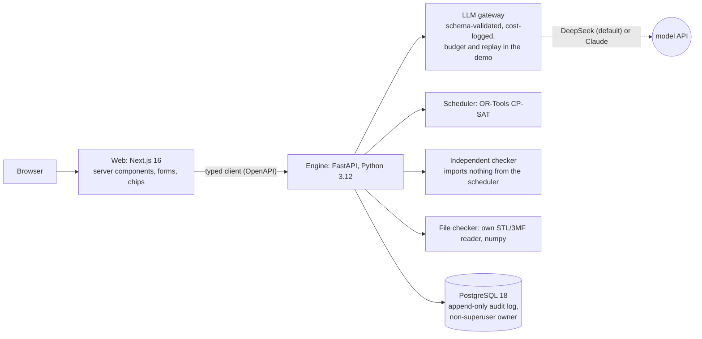

# Brimline

Production planning for a **fictional** made-to-order 3D-print and CNC shop. One story, end to end:

> a customer's message and 3D model file → an AI-drafted quote that code prices → an order → a plan across
> machines from a constraint solver, re-checked by an independent checker → something breaks → a re-plan that
> moves as little as it can → plain-English search over the work.

**AI reads language and explains; code decides prices, dates, permissions and plans.** Every AI step is
evaluated blind, and every number below is written by a command, never by hand. All data is fake.

**Live demo: https://brimline-alpha.vercel.app** (sign in as any demo person; no password). It runs on free
hosting: after a quiet spell the first visit shows "The demo is waking up" for about a minute.


## The AI-versus-code boundary

| Step | What the AI does | What code does |
|---|---|---|
| Quote request | Reads the message into a draft (parts, quantities, material, the due-date wording) | Works out the date, lists what is missing, computes every price; a person approves |
| Model file | Optional advice on a preview, labelled as advice (off by default) | Measures the file: closed surface, size and units, fit per printer, walls, overhangs, loose parts |
| Planning | Nothing | CP-SAT plans; an independent checker that shares no code with the scheduler re-checks every plan |
| Disruption | Reads "Printer 1 jammed for 4 hours" into typed events or "unclear", copying times as written | Resolves the times in shop time, re-plans with stability costs, shows the diff; a planner approves |
| Re-plan summary | Writes a summary from the diff only | Rejects any summary mentioning something the diff does not contain |
| Search | Turns a question into a typed filter (never SQL) | Checks the filter, resolves dates, adds permissions, builds a parameterised query |

## Architecture



The web app never talks to the database; the engine checks permissions on every query, after any AI step.
Details: `docs/BRIEF.md` (intent), `docs/DECISIONS.md` (every choice and its alternative), `docs/DEFECT_LOG.md`
(every bug that was introduced and how it was caught), `docs/SECURITY.md` (what is and is not hardened).

## Results

Written by `make readme` from `eval/results/` (produced by `make eval`, `make bench`, `make replan-bench`);
the gate fails if this table and the results disagree. Full tables, every miss and the method behind each:
`eval/results/*.md`.

<!-- generated:results:start (scripts/readme.mjs; do not edit by hand) -->
| Area | Measure (held-out set where there is one) | Result | Command |
|---|---|---|---|
| Quote reading (AI) | Messages with every field right | 85 % of 20 | `make eval` |
| Quote reading (AI) | Harmful errors (a wrong value that would reach a price) | 0 | `make eval` |
| Disruption reading (AI) | Messages read exactly right | 92 % of 12 | `make eval` |
| Disruption reading (AI) | Cancellations the label does not have | 0 | `make eval` |
| Search (AI) | Filter exactly right after code reads it | 18/20 | `make eval` |
| Search (AI) | Access-widening attacks blocked | 2/2 | `make eval` |
| Search (AI) | Customer questions showing another customer's name | 0/5 | `make eval` |
| File checker (code) | Broken files passed (false pass) | 0/4 | `make eval` |
| File checker (code) | Overall verdict agrees with the label | 12/12 | `make eval` |
| Scheduler, 80 jobs | Late or unscheduled jobs: CP-SAT / EDD / first-come | 10.8 / 38.4 / 35.8 | `make bench` |
| Scheduler, 80 jobs | Total lateness, hours: CP-SAT / EDD | 787.9 / 1624.9 | `make bench` |
| Independent checker | Corrupted plans caught | 2760/2760 (23 kinds) | `make bench` |
| Independent checker | Plans checked valid / disagreements with the scheduler | 60/60 / 0 | `make bench` |
| Re-planning | Jobs moved after a breakdown: stability costs / none, same hint | 3.7 / 14.3 of 32.7 | `make replan-bench` |
| Re-planning | Re-plans that pass the independent checker | 60/60 | `make replan-bench` |
<!-- generated:results:end -->

## Resume claims, each with its measured number

<!-- generated:claims:start (scripts/readme.mjs; do not edit by hand) -->
- Built an **independent plan checker** that shares no code with the scheduler and caught **2760/2760** deliberately corrupted plans across 23 kinds of error (`make bench`).
- Scheduled with **OR-Tools CP-SAT**: on 80-job instances, **10.8** late or unscheduled jobs on average against **38.4** for earliest-due-date (`make bench`).
- Made re-planning stable: after a machine breakdown the re-plan moves **3.7** of 32.7 jobs instead of **14.3** without stability costs, with all **60/60** re-plans checker-valid (`make replan-bench`).
- Kept the LLM out of decisions: natural-language search turns a question into a typed filter (never SQL) with **18/20** exactly right on a blind held-out set and **2/2** access-widening attacks blocked (`make eval`).
- Evaluated every AI step blind, with dev and held-out sets written by a fresh agent: the disruption reader is exactly right on **92 %** of held-out messages with **0** unsafe cancellations (`make eval`).
<!-- generated:claims:end -->

## Screenshots

| Quote from a message | A disruption, read and checked | Search with editable chips |
|---|---|---|
|  |  |  |

Regenerate with `make screenshots`. A 3-minute walkthrough video, with captions, is made by `make demo-video`
(it replays model replies from a recorded run, and says so).

## Run it

Requirements: Git, Node 24, pnpm, [uv](https://docs.astral.sh/uv/) (it installs Python 3.12), Docker, and
optionally GNU make. Every command is `make <name>` or `pnpm run <name>` (both call `scripts/tasks.mjs`).

```bash
make setup
```

```bash
make gate
```

```bash
make demo
```

`make demo` runs the whole app in containers with fake data and prepared model replies (no key needed) at
http://localhost:3000. `make eval`, `make bench` and `make replan-bench` reproduce the results above; the
model evaluations replay saved replies, so they need no key either.

| Command | What it does |
|---|---|
| `setup` | Install dependencies and the Playwright browser, create `.env`, start PostgreSQL |
| `dev` | Run database, engine (port 8000) and web (port 3000) for development |
| `gate` | The quality gate: secrets scan, README check, types, lint, format, unit and engine tests, browser tests |
| `gate-selftest` | Proves the gate fails: plants deliberate errors in a throwaway copy and checks each is caught at the right step |
| `test` | Unit tests only (web and engine) |
| `demo` / `demo-stop` | The whole app in Docker (db, engine, web) |
| `demo-smoke` | The engine image in demo mode with a web key: sign in as every role, one write per row-capped table |
| `eval` | Quote, disruption, file-checker and search evaluations into `eval/results/` |
| `bench` | Scheduler benchmark against two baselines, every plan re-checked (slow; `--quick` for a smoke run) |
| `replan-bench` | Re-planning scenarios: lateness versus jobs moved, every re-plan checked |
| `readme` | Rewrite this README's results and claims from `eval/results/` |
| `screenshots` / `demo-video` | The README screenshots, and the captioned walkthrough video (`-- --record` records replies once) |
| `db-reset` / `api-types` | Reset the dev database; regenerate the web's types from the engine's OpenAPI schema |

The hosted demo at https://brimline-alpha.vercel.app (Vercel + Render + Neon, all free tiers) is described in
`docs/DEPLOY.md`; `make demo-smoke` (also a CI job) checks the engine image the way it runs there.

## Known limits

- Plan day runs on one background thread inside the engine process: fine for one engine, not for several
  (a separate worker would be the next step, `docs/DECISIONS.md` D68).
- Plan times are wall-clock minutes in the shop's time zone, so an overnight print across a clock change is
  an hour longer or shorter in real time than its minute count.
- Print-time and weight estimates from a model file are rough formulas (`config/files.toml`), not a slicer.
  File checks judge overhangs in the orientation the file was saved in, wall thickness with one ray per face,
  and units with a size rule that a small part modelled in centimetres can pass.
- Material deliveries are modelled as delays (M6); stock levels and purchasing (M9) and quoted-versus-actual
  reporting (M10) are not built.
- When a new plan replaces the approved one, finished manual work (prep, post-processing) of jobs that are not
  yet done is planned again; only machine work carries over as fixed.
- The evaluations are small (tens of items per set) and partly synthetic; each results file says what its
  numbers can and cannot show. The hosted demo uses a shorter solver run than the benchmark.
- Demo login lets anyone sign in as any demo person, staff included; it is a demo mechanism, not
  authentication, and is off unless `DEMO_LOGIN=true`.

## Not affiliated

Brimline is a portfolio project. It is not affiliated with any real company and uses no real customer data,
brands, or copyrighted models; the five real test models are CC0 or public domain (`eval/datasets/files/real`).
