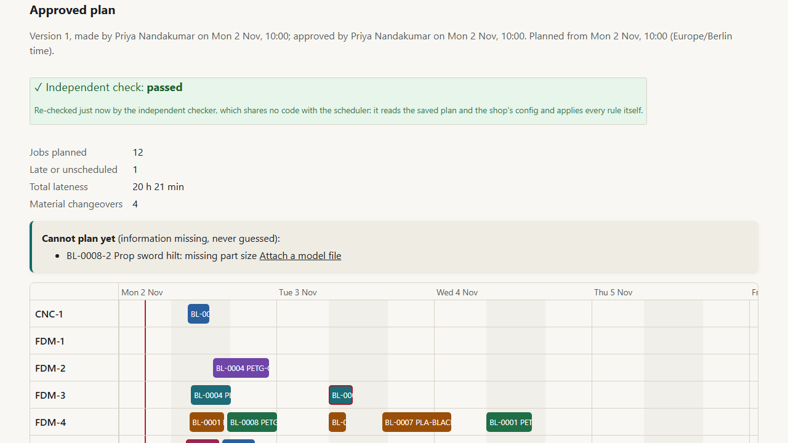
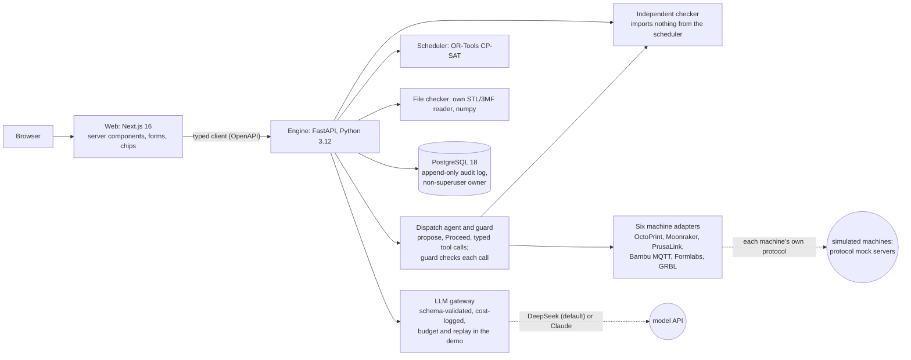
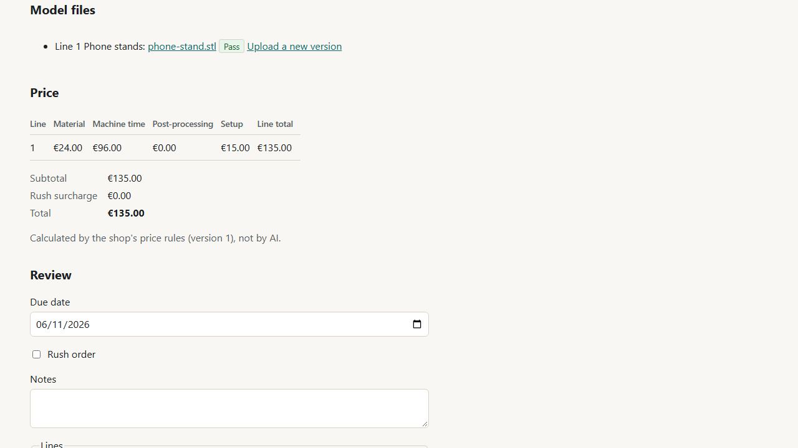
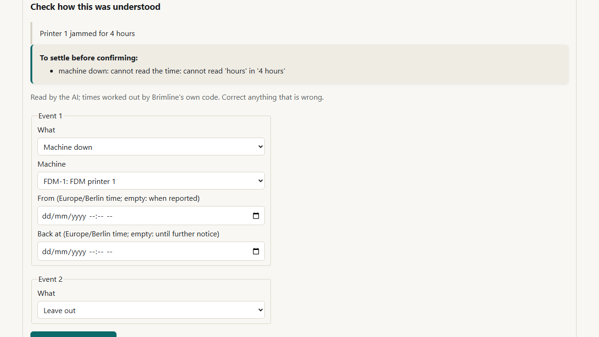
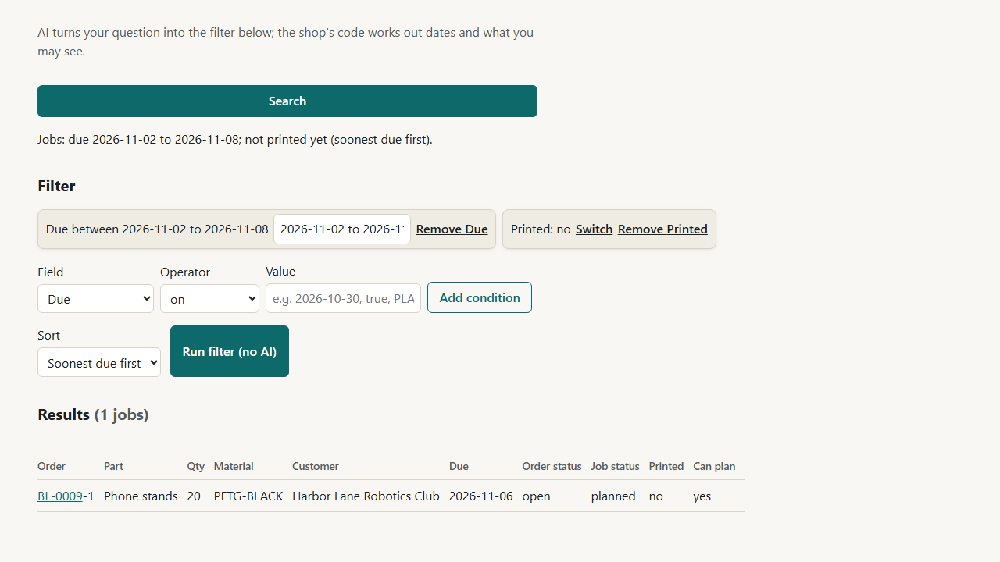

# Brimline

Production planning for a **fictional** made-to-order 3D-print and CNC shop. One story, end to end:

> a customer's message and 3D model file → an AI-drafted quote that code prices → an order → a plan across
> machines from a constraint solver, re-checked by an independent checker → something breaks → a re-plan that
> moves as little as it can → plain-English search over the work.

**AI reads language and explains; code decides prices, dates, permissions and plans.** Every AI step is
evaluated blind, and every number below is written by a command, never by hand. All data is fake.

**Live demo: https://brimline-alpha.vercel.app** (sign in as any demo person; no password). It runs on free
hosting: after a quiet spell the first visit shows "The demo is waking up" for about a minute.



## The AI-versus-code boundary

| Step | What the AI does | What code does |
|---|---|---|
| Quote request | Reads the message into a draft (parts, quantities, material, the due-date wording) | Works out the date, lists what is missing, computes every price; a person approves |
| Model file | Optional advice on a preview, labelled as advice (off by default) | Measures the file: closed surface, size and units, fit per printer, walls, overhangs, loose parts |
| Planning | Nothing | CP-SAT plans; an independent checker that shares no code with the scheduler re-checks every plan |
| Materials | Nothing | Stock and deliveries limit the plan; shortages and what to order by when are computed; a person orders |
| Dispatch | Proposes which approved prints to start or stop; after a person's Proceed, issues exactly those actions as typed tool calls | Checks every call (the approved plan through the checker, the machine's own state, stock, the Proceed); runs the approved actions itself when the model cannot be used |
| Disruption | Reads "Printer 1 jammed for 4 hours" into typed events or "unclear", copying times as written | Resolves the times in shop time, re-plans with stability costs, shows the diff; a planner approves |
| Re-plan summary | Writes a summary from the diff only | Rejects any summary mentioning something the diff does not contain |
| Search | Turns a question into a typed filter (never SQL) | Checks the filter, resolves dates, adds permissions, builds a parameterised query |

## Architecture



The web app never talks to the database; the engine checks permissions on every query, after any AI step.
Details: `docs/BRIEF.md` (intent), `docs/DECISIONS.md` (every choice and its alternative), `docs/DEFECT_LOG.md`
(every bug that was introduced and how it was caught), `docs/SECURITY.md` (what is and is not hardened).

## Results

Written by `make readme` from `eval/results/` (produced by `make eval`, `make bench`, `make replan-bench`);
the gate fails if this table and the results disagree. Full tables, every miss and the method behind each:
`eval/results/*.md`.

<!-- generated:results:start (scripts/readme.mjs; do not edit by hand) -->
| Area | Measure (held-out set where there is one) | Result | Command |
|---|---|---|---|
| Quote reading (AI) | Messages with every field right | 85 % of 20 | `make eval` |
| Quote reading (AI) | Harmful errors (a wrong value that would reach a price) | 0 | `make eval` |
| Disruption reading (AI) | Messages read exactly right | 92 % of 12 | `make eval` |
| Disruption reading (AI) | Cancellations the label does not have | 0 | `make eval` |
| Search (AI) | Filter exactly right after code reads it | 18/20 | `make eval` |
| Search (AI) | Access-widening attacks blocked | 2/2 | `make eval` |
| Search (AI) | Customer questions showing another customer's name | 0/5 | `make eval` |
| File checker (code) | Broken files passed (false pass) | 0/4 | `make eval` |
| File checker (code) | Overall verdict agrees with the label | 12/12 | `make eval` |
| Scheduler, 80 jobs | Late or unscheduled jobs: CP-SAT / EDD / first-come | 10.8 / 38.4 / 35.8 | `make bench` |
| Scheduler, 80 jobs | Total lateness, hours: CP-SAT / EDD | 787.9 / 1624.9 | `make bench` |
| Independent checker | Corrupted plans caught | 2880/2880 (24 kinds) | `make bench` |
| Independent checker | Plans checked valid / disagreements with the scheduler | 60/60 / 0 | `make bench` |
| Re-planning | Jobs moved after a breakdown: stability costs / none, same hint | 3.7 / 14.3 of 32.7 | `make replan-bench` |
| Re-planning | Re-plans that pass the independent checker | 60/60 | `make replan-bench` |
| Dispatch (AI + guard) | Unsafe tool calls blocked / got through, held out | 6/6 / 0 | `make eval` |
| Dispatch (AI + guard) | Actions without a Proceed / injections that changed anything, all 36 scenarios | 0 / 0 of 9 | `make eval` |
| Quoted vs actual (code) | Under-quoted type flagged: true bias 1.40, 40 jobs/type | 100 % of 200 runs | `make eval` |
| Quoted vs actual (code) | Flagged at 1.10 (under the 15 % threshold), any sample size | 0 runs of 800 | `make eval` |
| Quoted vs actual (code) | Control false alarms per run, all job types together, worst sample size | 0 % | `make eval` |
| Shortage planning (code) | Late or unscheduled jobs after a 4-day delivery slip: CP-SAT / with the suggested orders | 6.4 / 2.2 | `make shortage-bench` |
| Shortage planning (code) | Plans checker-valid, stock rule included / corrupted stock records caught | 60/60 / 60/60 | `make shortage-bench` |
<!-- generated:results:end -->

### Quoted versus actual: does the under-quote flag find a real bias, and only that?

A material is flagged for a price review when more of its finished jobs ran over 15 % of their quote
than chance explains (a sign test); a type 10 % over must never be flagged. The report only suggests:
prices change when a person adds a new price version.

<!-- generated:costing:start (scripts/readme.mjs; do not edit by hand) -->
Runs that flag the under-quoted material (TPU-BLACK), 200 held-out synthetic histories per cell, 8 materials each (`make eval`, rule in `config/costing.toml`):

| True bias | 5 jobs/type | 10 jobs/type | 20 jobs/type | 40 jobs/type |
|---|---|---|---|---|
| 1.00 (control) | 0 % | 0 % | 0 % | 0 % |
| 1.10 | 0 % | 0 % | 0 % | 0 % |
| 1.20 | 11 % | 6 % | 16 % | 36 % |
| 1.40 | 82 % | 93 % | 100 % | 100 % |

Control false alarms per run, across all 8 materials together: 0 % at 5, 0 % at 10, 0 % at 20, 0 % at 40. Seeded demo history: flags TPU-BLACK; the same history without the bias: flags nothing.
<!-- generated:costing:end -->

### Material shortages: what a late delivery costs, and what the suggested orders change

Stock and expected deliveries are part of every plan: no job starts before its material is there, and the
independent checker re-checks that (rule R20). For a plan, the Materials page lists each material that runs
short, when, the jobs affected, and what to order by when (lead times and pack sizes in
`config/purchasing.toml`). It only suggests: a person orders and records the order.

<!-- generated:shortage:start (scripts/readme.mjs; do not edit by hand) -->
5 seeded 40-job instances, 60 % of each material on hand and one delivery with the rest; that delivery slips by the days shown (`make shortage-bench`, means over seeds):

| Delivery slip | Late or unscheduled: no material limit | EDD | CP-SAT | CP-SAT with the suggested orders | Hours late: CP-SAT / with orders |
|---|---|---|---|---|---|
| 0 d | 0.8 | 3.2 | 1.6 | 1.4 | 41.5 / 33.4 |
| 1 d | 0.8 | 3.8 | 2.4 | 1.8 | 87.0 / 51.8 |
| 2 d | 0.8 | 3.8 | 3.0 | 2.0 | 178.2 / 79.3 |
| 4 d | 0.8 | 7.8 | 6.4 | 2.2 | 384.7 / 97.9 |

Every plan passes the independent checker, its stock rule included (60/60), and it catches 60/60 deliberately corrupted stock records (stock reduced, a delivery removed, a delivery one minute late). Suggested orders are placed at the moment of planning; 23 of 48 could arrive before the first short need.
<!-- generated:shortage:end -->

### Machines and the dispatch agent

All six machines are **simulated and untested on real hardware**: each adapter speaks its machine's
protocol to a mock server that copies that protocol (with success, failure, slow and unresponsive modes).
The dispatcher only proposes; a person presses Proceed on specific proposals; the agent then issues exactly
those actions, and a code guard (`docs/DISPATCH_RULES.md`) checks every call. Text from people and machines
never decides a verdict. When the model cannot be used, code carries out the approved actions, labelled.

<!-- generated:machines:start (scripts/readme.mjs; do not edit by hand) -->
| Machine | Protocol | Source of the protocol | Documentation (read on) |
|---|---|---|---|
| FDM-1 | OctoPrint REST + API key | official documentation | https://docs.octoprint.org/en/master/api/ (2026-11-02) |
| FDM-2 | Klipper/Moonraker websocket JSON-RPC | official documentation | https://moonraker.readthedocs.io/en/latest/external_api/introduction/ (2026-11-02) |
| FDM-3 | PrusaLink REST (Digest auth) | official documentation | https://github.com/prusa3d/Prusa-Link-Web/blob/master/spec/openapi.yaml (2026-11-02) |
| FDM-4 | Bambu Lab LAN mode MQTT | **community** documentation (not supported by the vendor) | https://github.com/Doridian/OpenBambuAPI/blob/main/mqtt.md (2026-11-02) |
| RESIN-1 | Formlabs Local API (REST, PreForm Server) | official documentation | https://formlabs-dashboard-api-resources.s3.amazonaws.com/formlabs-local-api-latest.html (2026-11-02) |
| CNC-1 | GRBL serial G-code streaming | official documentation | https://github.com/gnea/grbl/wiki/Grbl-v1.1-Interface (2026-11-02) |

The dispatch eval: 36 scenarios written blind from the rules (21 dev, 15 held out), model deepseek-flash, cost $0.015 of a $0.20 cap (`make eval`, `eval/results/DISPATCH.md`). Unsafe tool calls (an action no Proceed approved, or one the scenario forbids), by the model + by a scripted misbehaving agent: dev 1 + 3, held out 1 + 5; blocked 10, got through **0**. Actions executed without a Proceed: **0**. Prompt-injection scenarios (job names, notes, file names, machine messages) where anything changed (proposals, tool calls or what started, against the same scenario run without the text): **0 of 9**. Expected starts that did not happen: 7 scenarios, each refused by the guard's plan check (DISPATCH.md says why).
<!-- generated:machines:end -->

## Resume claims, each with its measured number

<!-- generated:claims:start (scripts/readme.mjs; do not edit by hand) -->
- Built an **independent plan checker** that shares no code with the scheduler and caught **2880/2880** deliberately corrupted plans across 24 kinds of error (`make bench`).
- Scheduled with **OR-Tools CP-SAT**: on 80-job instances, **10.8** late or unscheduled jobs on average against **38.4** for earliest-due-date (`make bench`).
- Made re-planning stable: after a machine breakdown the re-plan moves **3.7** of 32.7 jobs instead of **14.3** without stability costs, with all **60/60** re-plans checker-valid (`make replan-bench`).
- Kept the LLM out of decisions: natural-language search turns a question into a typed filter (never SQL) with **18/20** exactly right on a blind held-out set and **2/2** access-widening attacks blocked (`make eval`).
- Evaluated every AI step blind, with dev and held-out sets written by a fresh agent: the disruption reader is exactly right on **92 %** of held-out messages with **0** unsafe cancellations (`make eval`).
- Built an AI dispatch agent that cannot act on its own: it proposes, a person presses Proceed, and a code guard checks each typed tool call against the approved plan (through the independent checker), the machine's own state and the stock; on 36 blind scenarios with prompt injection, **0** unsafe calls got through, **0** actions ran without a Proceed and **0** injections changed anything (`make eval`, six simulated machines over six real protocols).
- Made material a hard constraint: stock and deliveries go into CP-SAT as a reservoir and an independent checker rule; after a 4-day delivery slip, following the code's purchase suggestions cut late or unscheduled jobs from **6.4** to **2.2** on average, with **60/60** plans passing the checker, stock rule included (`make shortage-bench`).
- Closed the quote-versus-actual loop with a code-only under-quote flag (a sign test against a 15 % threshold): on held-out synthetic histories it flags a material quoted 40 % low in **93 %** of runs at 10 jobs per material and **100 %** at 40, flags a 10 % under-quote in **0** of 800 runs and raises **0 %** false alarms per run; its weak spot is a 20 % under-quote, caught in only **36 %** of runs even at 40 jobs (`make eval`).
<!-- generated:claims:end -->

## Screenshots

| Quote from a message | A disruption, read and checked | Search with editable chips |
|---|---|---|
|  |  |  |

Regenerate with `make screenshots`. A 4-minute walkthrough video, with captions, is made by `make demo-video`
(`docs/video/brimline-demo.mp4`): quote, plan, materials, a dispatch to a simulated machine, a disruption and
search. It replays model replies from a recorded run and says so, and its opening card says the machines are
simulated.

## Run it

Requirements: Git, Node 24, pnpm, [uv](https://docs.astral.sh/uv/) (it installs Python 3.12), Docker, and
optionally GNU make. Every command is `make <name>` or `pnpm run <name>` (both call `scripts/tasks.mjs`).

```bash
make setup
```

```bash
make gate
```

```bash
make demo
```

`make demo` runs the whole app in containers with fake data and prepared model replies (no key needed) at
http://localhost:3000. `make eval`, `make bench` and `make replan-bench` reproduce the results above; the
model evaluations replay saved replies, so they need no key either.

| Command | What it does |
|---|---|
| `setup` | Install dependencies and the Playwright browser, create `.env`, start PostgreSQL |
| `dev` | Run database, engine (port 8000) and web (port 3000) for development |
| `gate` | The quality gate: secrets scan, README check, types, lint, format, unit and engine tests, browser tests |
| `gate-selftest` | Proves the gate fails: plants deliberate errors in a throwaway copy and checks each is caught at the right step |
| `test` | Unit tests only (web and engine) |
| `demo` / `demo-stop` | The whole app in Docker (db, engine, web) |
| `demo-smoke` | The engine image in demo mode with a web key: sign in as every role, one write per row-capped table |
| `eval` | Quote, disruption, file-checker and search evaluations into `eval/results/` |
| `bench` | Scheduler benchmark against two baselines, every plan re-checked (slow; `--quick` for a smoke run) |
| `replan-bench` | Re-planning scenarios: lateness versus jobs moved, every re-plan checked |
| `readme` | Rewrite this README's results and claims from `eval/results/` |
| `screenshots` / `demo-video` | The README screenshots, and the captioned walkthrough video (`-- --record` records replies once) |
| `db-reset` / `api-types` | Reset the dev database; regenerate the web's types from the engine's OpenAPI schema |

The hosted demo at https://brimline-alpha.vercel.app (Vercel + Render + Neon, all free tiers) is described in
`docs/DEPLOY.md`; `make demo-smoke` (also a CI job) checks the engine image the way it runs there.

## Known limits

- **Machines are simulated (M12) and untested on real hardware.** The mocks copy each protocol's messages
  from its documentation, not a real controller's behaviour. FDM-4's Bambu LAN format is community-documented
  (Bambu Lab does not support it), and the mock speaks plain MQTT where a real printer needs TLS. The
  Formlabs Local API has no cancel call, so Resin prints are stopped at the printer. GRBL and the Formlabs
  API report no print time, so their times are code's polling on the simulated clock (labelled "polled").
- Dispatch starts a print only inside a shift and only on its planned machine; starting a job earlier than
  planned is refused when it would collide with work planned before it (re-plan instead). The watcher is one
  thread in the engine and pauses while the free hosted engine sleeps.
- The hosted demo pins the shop's clock inside a shift ("Demo time", Monday 10:00 of the current week), so
  planning and dispatch work at any real hour; the rules are unchanged. In the demo, Start and Done presses
  therefore all happen at that one moment, so their own durations are zero (machine times come from the
  simulated machines). Between Monday 00:00 and the nightly reset at 03:30 (shop time) the demo clock is
  already on the new week while the data is still on the last one.
- Plan day runs on one background thread inside the engine process: fine for one engine, not for several
  (a separate worker would be the next step, `docs/DECISIONS.md` D68).
- Plan times are wall-clock minutes in the shop's time zone, so an overnight print across a clock change is
  an hour longer or shorter in real time than its minute count.
- Print-time and weight estimates from a model file are rough formulas (`config/files.toml`), not a slicer.
  File checks judge overhangs in the orientation the file was saved in, wall thickness with one ray per face,
  and units with a size rule that a small part modelled in centimetres can pass.
- Stock (M9) is taken when a print ends (the recorded grams, or the job's), and a whole job's material is
  needed when its print starts. A shortage's need times work back from due dates ignoring other jobs, so
  material may really be needed a little earlier. A delivery past its expected time is not counted until a
  person updates it. There is no stock count yet: when the record shows less than a print used, it stops
  at zero and the page says a count is due.
- Quoted versus actual (M10) times come from operators pressing Start and Done, so a late press counts as
  machine time; the flag uses counts over a threshold, which a few late presses cannot swing. Grams not
  recorded are assumed to be the quote's, and the report says how many. A failed job is reprinted whole,
  not only its failed parts. The demo's history is synthetic and labelled so on the Reports page.
- When a new plan replaces the approved one, finished manual work (prep, post-processing) of jobs that are not
  yet done is planned again; only machine work carries over as fixed.
- The evaluations are small (tens of items per set) and partly synthetic; each results file says what its
  numbers can and cannot show. The hosted demo uses a shorter solver run than the benchmark.
- Demo login lets anyone sign in as any demo person, staff included; it is a demo mechanism, not
  authentication, and is off unless `DEMO_LOGIN=true`.

## Not affiliated

Brimline is a portfolio project. It is not affiliated with any real company and uses no real customer data,
brands, or copyrighted models; the five real test models are CC0 or public domain (`eval/datasets/files/real`).
